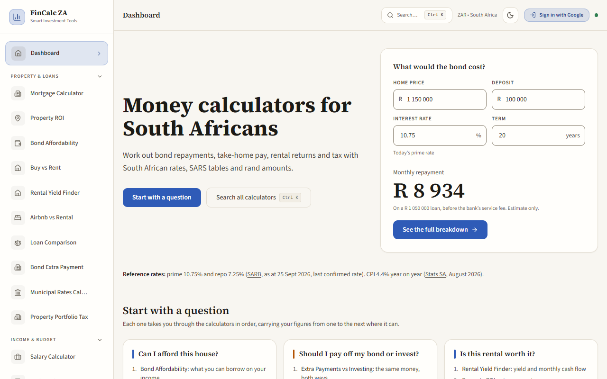
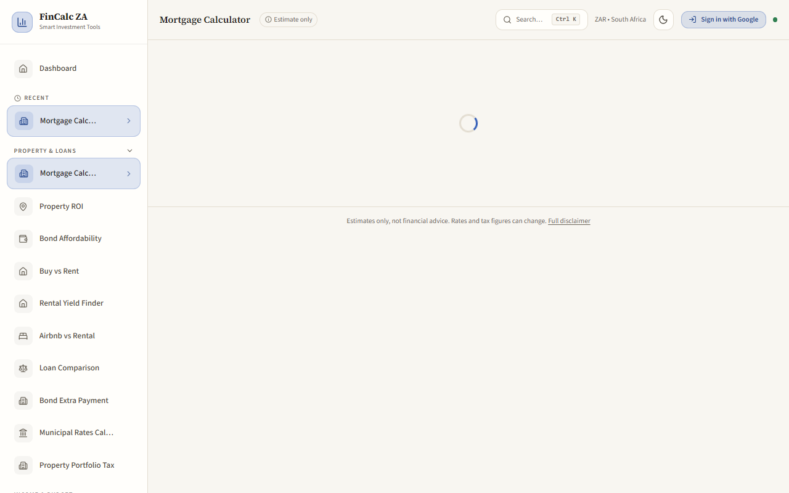
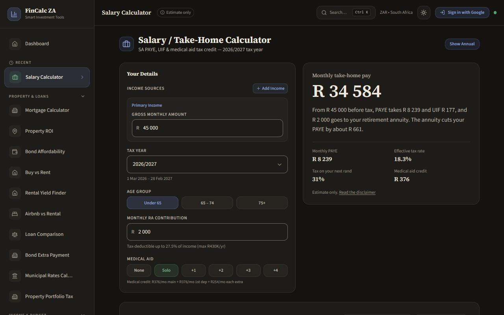

# FinCalc ZA

**Plain-language money calculators for South Africans.** Work out a bond, a salary, a car deal, your tax or your retirement in rand, with SARS 2026/27 figures, the live SARB prime rate and a clear sentence explaining every answer.

**Live app:** [financial-calculator-za.vercel.app](https://financial-calculator-za.vercel.app) · **Version:** 2.0.0 · [What's new](CHANGELOG.md)



> FinCalc ZA gives estimates for education. It is not financial or tax advice. Speak to a registered financial planner or tax practitioner before making a decision.

<p>
  
  
</p>

## What's new in 2.0

Version 2 is a redesign and a full recheck of the numbers.

- **A new look:** a paper-and-ink design in light and dark, with banknote colours for each category and self-hosted Source Serif and Source Sans fonts.
- **Answers you can read:** every calculator leads with the result and a sentence in plain language, followed by payslip-style statements and a drawer listing its assumptions.
- **Journeys:** guided paths that carry your numbers from one calculator to the next, such as checking what you can afford, then the bond, then the rates.
- **Corrected figures:** Budget 2026 limits are applied everywhere, and dozens of calculations were fixed. The [changelog](CHANGELOG.md) lists them, including results that were wrong in earlier versions.
- **Tighter safety:** input checks on every field, a recovery screen if a page fails, patched dependencies and automated checks on every change.

## Calculators

40 tools, grouped the way the app groups them. Press `Ctrl/Cmd + K` anywhere to jump to one.

| Area | Tools |
|---|---|
| **Property and loans** | Mortgage, Property ROI, Bond Affordability, Buy vs Rent, Rental Yield Finder, Airbnb vs Rental, Loan Comparison, Bond Extra Payment, Municipal Rates, Property Portfolio Tax |
| **Income and budget** | Salary, Budget Planner, Debt Snowball, Emergency Fund, Provisional Tax, Retrenchment, VAT |
| **Vehicles** | Car Finance (the balloon is optional), Car: Extra vs Investing |
| **Investing and tax** | Extra vs Investing, Wealth Target, Offshore Allowance, Investment Strategy, SARS Assessment Estimator, SARS Code Lookup, Tax Planner, Tax Projections, Dividend Income, Optimal Exit Planner, TFSA Optimizer, RA Planner, FIRE, Retirement Income Goal |
| **Planning** | Net Worth, Portfolio Summary, Portfolio Stress Test, Inflation, Education Savings |
| **My portfolio** | Portfolio Manager with expenses, income, maintenance and records per property, and Calculation History with side-by-side compare |

The **Learn** section adds 16 articles on South African tax, property, debt, investing and retirement, each linked to the matching calculator.

### Across the app

- **Save and sync:** sign in with Google to keep snapshots, properties and budgets on any device. Everything else works without an account.
- **Share a scenario:** most calculators can put their inputs in a link.
- **Export:** PDF and Excel on the main calculators.
- **Your inputs stay:** several calculators remember your last values on your device.
- **Built for phones:** the layout works from 360 px wide, in light and dark.

## South African figures

Tax years are configured in [`src/config/taxYears.ts`](src/config/taxYears.ts), and reference rates with their sources in [`src/config/referenceRates.ts`](src/config/referenceRates.ts).

| Figure | Value | Source |
|---|---|---|
| Prime and repo rate | Live from SARB, with a fallback of 10.75% and 7.25% | SARB, September 2026 |
| Tax tables | 2026/27 by default, with the earlier year selectable | SARS |
| TFSA limit | R46,000 a year, R500,000 lifetime | Budget 2026 |
| Retirement deduction | 27.5% of income, capped at R430,000 | Budget 2026 |
| CGT | 40% inclusion, R50,000 annual exclusion, R3m primary residence exclusion | Budget 2026 |
| VAT | 15%, compulsory registration at R2.3m, voluntary at R120,000 | SARS |
| Municipal tariffs | 2026/27 for Johannesburg and Cape Town, estimates for the other metros | Council tariff schedules |

The Municipal Rates page says whether a city's figures are confirmed, and only confirmed cities are named as cheaper.

## Tech stack

Vite, React 19 and TypeScript (strict), Tailwind CSS 4 with daisyUI 5, React Router 7, Recharts 3, Framer Motion, Firebase Auth and Firestore, jsPDF and SheetJS for exports, Vitest for testing, hosted on Vercel with one serverless route for the SARB rate.

```
api/prime-rate.ts       SARB proxy, cached at the CDN
firestore.rules         Owner-only access to user data
src/
  components/results/   Result panel, breakdown list, assumptions drawer
  components/statement/ Payslip-style statement rows
  config/               Navigation, tax years, reference rates, journeys
  journeys/             Moving values between calculators
  pages/                One file per calculator or tool
  utils/                Calculation logic, kept apart from the UI
  test/                 Vitest tests
```

## Run it yourself

You need Node.js 22, npm, and a Firebase project with Google sign-in and Firestore enabled.

```bash
git clone https://github.com/Sash3n/investment_calculator.git
cd investment_calculator
npm ci
git config core.hooksPath .githooks
```

Create `.env.local` from your Firebase web app settings. These values are public identifiers that ship in the browser bundle, and access is controlled by the Firestore rules.

```
VITE_FIREBASE_API_KEY=
VITE_FIREBASE_AUTH_DOMAIN=your-project.firebaseapp.com
VITE_FIREBASE_PROJECT_ID=
VITE_FIREBASE_STORAGE_BUCKET=
VITE_FIREBASE_MESSAGING_SENDER_ID=
VITE_FIREBASE_APP_ID=
```

`VITE_FIREBASE_AUTH_DOMAIN` must be the `.firebaseapp.com` domain, or Google sign-in fails. Deploy the rules with `npx firebase deploy --only firestore:rules`.

```bash
npm run dev      # http://localhost:5173
npm run build    # type check and production build
npm test         # unit tests
npm run lint     # lint
```

Every pull request runs the build, tests, lint and an attribution check. Merges to `main` deploy to production on Vercel.

## Security

Saved data is readable only by the signed-in owner, and everything else is denied by the Firestore rules. See [SECURITY.md](SECURITY.md) for how the app is protected and how to report a problem.

## License

[MIT](LICENSE)
